# A/C carrier: what to build and how to test it

Owner request, 2026-10-12: document the board and software work, then build and
test the PCB-creation software against this product. Product baseline:
`ff5323b20a75af194901a5418b5585963678c110`. This document is an implementation and
test plan; the source specifications and canonical BoardSpec remain authoritative.

## Board to build

Build a sensor carrier for the 4Runner A/C telemetry node with two separately
powered pressure channels, high-line/low-line/ambient temperature acquisition,
protected vehicle power, rail/reference health measurements, microSD logging and
service access. Preserve the current Pi/Arduino slide-cassette direction.

The [source reconciliation](source-reconciliation.md) records the selected
Nano baseline, later UNO-format ESP32-S3 candidate, Sensata pressure-family
ranges and earlier bench components. Resolve the actual controller connections
and sensor-PCB location before using that information in a wired design.

```mermaid
flowchart LR
    A[Verified requirements and exact parts] --> B[Power tree and pin budget]
    B --> C[Wired schematic and BOM]
    C --> D[Populated PCB and enclosure fit]
    D --> E[Native ERC/DRC and independent export checks]
    E --> F[Independent engineering and fabrication review]
    F --> G[Current-limited bring-up and sensor fault tests]
    G --> H[Vehicle, environmental and EMC qualification]
```

## Deliverables and acceptance

| Stage | Deliverable | Evidence needed to finish |
| --- | --- | --- |
| Requirements | Exact controller, pressure/probe/connector identities; power, acquisition, mechanical and test limits | All fourteen composite contract tasks resolved with immutable source evidence and engineering review |
| Architecture | Power tree, normal/fault calculations, GPIO/net/ADC budget, sensor isolation, storage and service boundary | Seven analog observations accommodated; the minimum 105 observations/s is converted into a measured ADC/settling schedule; actual controller supply and pin maps used |
| Schematic | Editable hierarchical KiCad schematic, complete BOM, qualified symbols/footprints and requirement mapping | Reviewed connections, independent HIGH/LOW power control, protection and fault calculations; no missing part or connector identity |
| Layout | Exact board outline, placements, routes, test points, stackup and populated STEP assembly | Actual cassette/connector/harness fit; USB/antenna/SD access, mounting and manufacturing constraints reviewed |
| Native verification | Native reopen, ERC/DRC/parity, applicable simulations and source/export comparison | Pinned Orion toolchain, raw reports, no hidden exclusions; missing models remain incomplete |
| Manufacturing/release | Native BOM/CPL/Gerber/drill/PDF/STEP package and assembly/bring-up instructions | Independent source/export fidelity, part identity, placement/rotation and CAM checks; exact engineering and fabrication approvals |
| Bench/firmware | Unit-bound power, pressure, temperature, storage and fault evidence | Current-limited setup; resolved stimulus/tolerance/calibration records; actual startup/ADC/rail/isolator/storage results |
| Vehicle/qualification | Installed assembly and measured application-specific results | Refrigerant-service/mechanical review, crank/transient, thermal, vibration, ingress/condensation and EMC acceptance limits and results |

Use [build-test-plan.json](build-test-plan.json) for the machine-readable task,
dependency and test matrix. Every listed hardware/EDA test starts as **NOT_RUN**
in a generated planning report. Actual execution evidence is a separate record.

## PCB software work

The current software generates a bounded editable LED candidate and reviews its
retained native evidence. A/C circuit generation needs additional capabilities:

| Work | Concrete implementation | Test against this product |
| --- | --- | --- |
| Product handoff and readiness report — implemented | Read a canonical BoardSpec plus typed build/test plan; verify actual local source hashes; map every significant field and active requirement to work and tests; retain exact input bytes and readable reports | Replay the real A/C snapshot; reject missing/changed sources, stale hashes, omitted requirements/fields, invalid dependencies and claims of completed tests or approval |
| Acquisition capacity planning — implemented | Allocate actual pressure/rail/reference demands against pinned channel and shared conversion limits; reserve reference inputs under an explicit draft policy; leave unspecified paths without invented capacity | Real-input replay, per-engine/aggregate traps, missing observations, stale source/cadence, strict rate settings, address collisions and exact rational boundaries; the two-ADC proposal fits necessary bounds while timing/electrical qualification stays incomplete |
| Reviewed circuit assets | Exact controller/header, automotive power, sensor switch, analog conditioning, ADC/reference, probe, storage, connector and test-point blocks | Manufacturer pin/part/footprint checks and preregistered normal/fault cases for each actual block |
| A/C schematic compiler | Compile only resolved, reviewed block instances into editable schematic and unrouted PCB with stable requirement/net identities | Deterministic replay, native reopen and oracle comparison; unresolved or unsupported inputs refuse compilation |
| Placement/routing | Place mounting/connectors first, then power/analog/digital blocks; apply reviewed net/geometry constraints | Actual enclosure STEP cross-fit, return-path/thermal review, complete native DRC/parity and routing mutations |
| Complete verifier/release workflow | Connect native EDA, calculations/simulations, manufacturing checks and identity-bound approvals | Open/short/polarity/pin/rail/part/coordinate/export mutations detected; changed artifacts invalidate approval |
| Firmware and physical loop | Acquire real selected sensors; retain raw values/calibration, health and power-loss evidence; relate each physical unit to the release | Actual fixture/hardware measurements, failure-to-revision records and repeatable unit tests |

The first two rows are implemented using the current incomplete product
inputs. The later rows depend on exact electrical contracts, reviewed assets,
native verification profiles and hardware. A source/readiness report does not
satisfy those dependencies or change the generator's supported design family.

## Test matrix

1. **Software/input integrity:** schema/hash validation, source capture, exact
   provenance, dependency/coverage checks, deterministic reports, read-only input
   behavior, path/symlink/output protection and approval-boundary regressions.
2. **Existing creation path:** rebuild the supported LED candidate twice and
   compare bytes; replay its actual retained Orion native BOM, position, preview,
   ERC and DRC evidence. Identify replay as retained evidence, not a fresh run.
3. **Native A/C EDA:** reopen/save-copy, ERC/DRC/parity, requirement/net mapping,
   duplicate/missing/miswired assets and output fidelity. A functional A/C
   schematic/layout is required before these tests can execute.
4. **Power:** normal/startup/max load, crank/restart, reverse/fault behavior,
   regulator thermal limits, independent sensor isolation and signal back-power.
5. **Pressure/ADC:** both exact sensors at calibrated endpoints and intermediate
   stimuli; rail/reference error, open/short/unpowered inputs, ground offset,
   settling/filter/rate and absolute/gauge metadata. No generic transfer is used.
6. **Temperature:** selected contact/ambient probes at calibrated stimuli,
   attachment error, open/short/stuck behavior and separation from die-health
   temperature. Missing external probes remain unavailable in firmware.
7. **Storage/service:** sustained selected-rate acquisition, bounded logs,
   power-loss recovery, card removal/faults, USB service, NVS preservation and
   rollback; recovery/temperature bench radio absence remains enforced.
8. **Mechanical/manufacturing:** populated assembly, connector travel, cable bends,
   actual screw/hole fit, polarity/rotation, native BOM/CPL/part/source and
   independent Gerber/drill alignment.
9. **Physical release:** independent review and approval of exact artifacts,
   calibrated equipment, assembly identity and measured acceptance results.

Numeric limits absent from the source must be selected and reviewed before the
relevant measurement can pass. Automotive-rated components, a clean DRC or
firmware compilation do not establish public/transportation/military compliance.

## Execution record

The [generic review command and regression guide](https://github.com/IsaiahDupree/pcb-agent/blob/main/docs/product-build-review.md)
describe the implemented first software increment. The
[generated product review](product-build-review/index.html) retains fourteen
actual input files, six source references, nine ordered build steps and thirteen
planned test groups. Its live-product and retained-fixture results are identical;
all fourteen significant contracts remain incomplete.

The real-input software regressions passed in 44 cases. The broader PCB suite
passed 1,942 tests with 92.72% coverage and 22 native Mac EDA skips under the
Orion placement rule. The supported LED creation path produced sixteen identical
files across two rebuilds; its retained Orion native evidence replay also
matched. These checks establish software behavior, not a functional A/C design.
The [execution receipt](evidence/product-build-test-2026-10-12.json) binds the
review, implementation, package and repository verification results.

The second software increment is the [draft acquisition plan](acquisition/README.md).
It retains the original seven-signal/105-conversion minimum and explicitly
accounts for a reference input on each converter in a two-ADC hypothesis:
eight input connections and 106 conversions/s. The unselected allocation uses
53 conversions/s per engine; source, fanout, conditioning, host pins and actual
schedule remain unresolved. Its 83 software regressions passed. The separate
[acquisition execution receipt](evidence/acquisition-test-2026-10-12.json) records
the broader suite and installed-package checks for that increment.

Do not mark schematic/layout generation, sensor acquisition or physical tests
complete from a planning or software-integrity pass.
